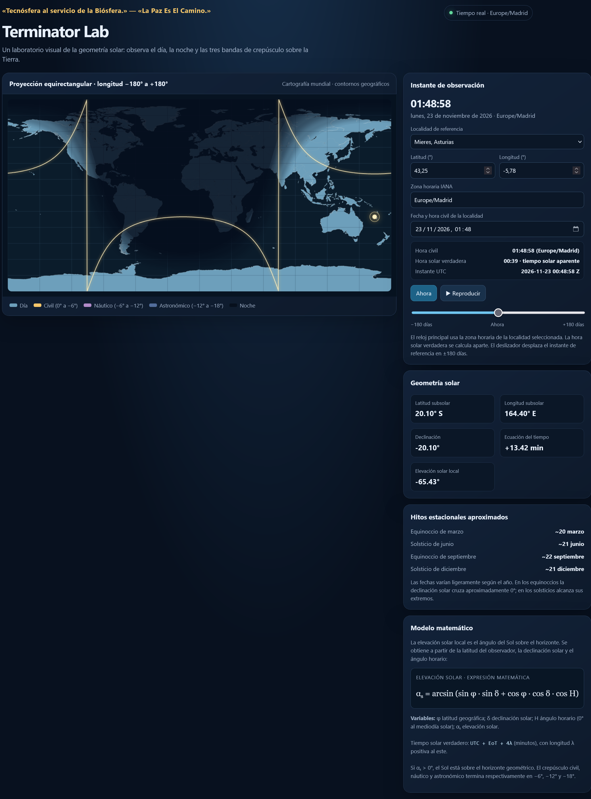

# 🌍 Terminator Lab

**Live Demo:** https://amurlaniakea.github.io/terminator-lab/

Laboratorio interactivo, didáctico y sin dependencias para visualizar el día, la noche y los crepúsculos terrestres sobre un mapa equirectangular. El renderizado se realiza en un único elemento HTML5 `<canvas>` con Canvas 2D y JavaScript nativo.

> **Propósito:** visualización educativa y exploración geométrica. No es un producto de navegación, astronomía de precisión ni una fuente para decisiones operativas.



## Características

- Posición subsolar calculada localmente a partir de una fecha/hora UTC.
- Declinación solar y ecuación del tiempo mediante la aproximación armónica NOAA de baja precisión.
- Máscara de iluminación calculada por píxel a partir del ángulo cenital solar.
- Bandas de crepúsculo civil, náutico y astronómico, con transiciones suavizadas.
- Línea del terminador geométrico (elevación solar de 0°) y punto subsolar.
- Reloj civil local por localidad y zona horaria IANA, además del instante UTC.
- Lectura de elevación solar local y fórmula explícita en notación LaTeX.
- Hora solar verdadera aparente calculada para las coordenadas de observación.
- Localidades predefinidas (Mieres, Madrid, Londres, Nueva York, Tokio, Tlaxcala y Honolulu (Hawái)) y coordenadas/zona horaria personalizables.
- Selector de fecha y hora civil local, control temporal de ±180 días y reproducción acelerada.
- Sin Leaflet, OpenLayers, React, Vue, paquetes npm ni APIs espaciales externas.
- Pruebas del motor matemático usando el módulo de pruebas integrado de Node.js.

## Estructura

```text
terminator-lab/
├── index.html
├── solar.js
├── package.json
├── README.md
├── LICENSE
├── assets/
│   └── world-map.svg
└── tests/
    └── solar.test.js
```

## Ejecución local

No se necesita instalar ninguna dependencia. Por las restricciones de seguridad del navegador al cargar imágenes locales, sirve el directorio mediante HTTP:

```bash
python3 -m http.server 8000
```

Abre <http://localhost:8000>.

También se incluye un script npm opcional:

```bash
npm run serve
```

Para ejecutar las pruebas (Node.js 18 o posterior):

```bash
npm test
```

No se necesita Node.js para utilizar la aplicación en el navegador; solo para ejecutar las pruebas.

## Modelo astronómico

### 1. Convenciones

- Instante astronómico: UTC, representado por `Date`. La interfaz convierte la fecha/hora civil introducida en la zona horaria seleccionada a un instante UTC.
- Zona horaria de presentación: identificador IANA (por ejemplo, `Europe/Madrid`), independiente de la zona horaria del servidor.
- Latitud: positiva hacia el norte.
- Longitud: positiva hacia el este.
- Ángulo horario: positivo hacia el oeste.
- Declinación solar: positiva cuando el Sol está al norte del ecuador celeste.
- Elevación solar: 0° en el horizonte geométrico; positiva sobre el horizonte.

### 2. Ángulo del año fraccional

Se calcula el día del año `N` y la fracción UTC del día `h`. El ángulo anual es:

$$
\gamma = \frac{2\pi}{D}\left(N-1+\frac{h-12}{24}\right)
$$

donde `D` es 365 o 366 según el año. Esta formulación es la aproximación armónica habitual del algoritmo solar de NOAA.

### 3. Ecuación del tiempo

La diferencia entre el tiempo solar aparente y el tiempo solar medio se aproxima en minutos por:

$$
\begin{aligned}
E_t = 229.18(&0.000075 + 0.001868\cos\gamma
-0.032077\sin\gamma\\
&-0.014615\cos 2\gamma
-0.040849\sin 2\gamma)
\end{aligned}
$$

El signo sigue la convención NOAA: `E_t` se suma a los minutos UTC para obtener el tiempo solar verdadero en longitud 0°.

### 4. Declinación solar

La declinación se aproxima en radianes mediante:

$$
\begin{aligned}
\delta ={}& 0.006918 - 0.399912\cos\gamma + 0.070257\sin\gamma\\
&-0.006758\cos 2\gamma + 0.000907\sin 2\gamma\\
&-0.002697\cos 3\gamma + 0.00148\sin 3\gamma
\end{aligned}
$$

La latitud subsolar es igual a la declinación solar.

### 5. Longitud subsolar

El tiempo solar verdadero local, en minutos, es:

$$
TST = (UTC_{min} + E_t + 4\lambda)\bmod 1440
$$

La longitud subsolar corresponde a `TST = 720` minutos:

$$
\lambda_{sub} = \operatorname{wrap}_{[-180,180)}
\left(\frac{720-UTC_{min}-E_t}{4}\right)
$$

`UTC_min` incluye horas, minutos, segundos y milisegundos transcurridos desde medianoche UTC. El factor de cuatro proviene de los cuatro minutos de tiempo solar por grado de longitud.

### 6. Elevación solar y máscara

Para una posición geográfica de latitud \(\varphi\), longitud \(\lambda\), declinación \(\delta\) y ángulo horario `H`:

$$
\sin(\alpha)=\sin\varphi\sin\delta+
\cos\varphi\cos\delta\cos H
$$

$$
\alpha = \arcsin(\sin\alpha)
$$

La aplicación calcula `α` para el centro de cada píxel del mapa. La localidad elegida solo modifica las lecturas de hora civil y hora solar; no altera la iluminación global del mapa. A partir de la elevación aplica una opacidad de sombreado:

| Elevación solar | Interpretación | Tratamiento visual |
|---:|---|---|
| > 0° | Día | Sin máscara nocturna |
| 0° a −6° | Crepúsculo civil | Sombreado tenue |
| −6° a −12° | Crepúsculo náutico | Sombreado medio |
| −12° a −18° | Crepúsculo astronómico | Sombreado intenso |
| < −18° | Noche astronómica | Sombreado máximo |

Los umbrales son convenciones astronómicas. Las opacidades y la suavización son decisiones gráficas, no una simulación radiométrica de la atmósfera.

## Arquitectura del renderizador

1. `world-map.svg` se carga como imagen de fondo equirectangular.
2. Se dibuja la imagen en el canvas.
3. `getImageData()` obtiene los píxeles y se calcula la elevación solar en cada centro de píxel.
4. Se aplica una máscara azul-negra con opacidad según la elevación.
5. Se dibuja el terminador geométrico y el punto subsolar.

El canvas interno es de 1200 × 600 píxeles y se escala mediante CSS. Para una resolución superior, ajusta los atributos `width` y `height` del canvas, teniendo presente que el coste de cálculo crece aproximadamente con el número de píxeles. El renderizado se limita a unas cinco actualizaciones por segundo para evitar trabajo innecesario; el reloj y el estado temporal se actualizan en el bucle de animación.

## Localidad y controles de tiempo

- **Localidad de referencia:** permite elegir Mieres, Madrid, Londres, Nueva York o Tokio.
- **Personalizada:** permite introducir latitud, longitud y una zona horaria IANA válida (por ejemplo, `Europe/Madrid` o `America/Argentina/Buenos_Aires`).
- **Fecha y hora civil:** se interpreta en la zona horaria elegida, no en la del servidor. La conversión se realiza en el navegador mediante `Intl` y el instante resultante se normaliza a UTC para los cálculos. En los cambios de horario de verano, algunas horas locales pueden ser inexistentes o ambiguas; para esos casos conviene elegir un minuto cercano no afectado.
- **Hora civil:** se muestra con la zona horaria seleccionada.
- **Hora solar verdadera:** se calcula con la ecuación del tiempo y la longitud del observador; no es la hora del reloj ni la hora UTC.
- **Instante UTC:** se muestra para que la conversión sea verificable.
- **Ahora:** vuelve al instante actual del dispositivo, presentado en la zona horaria elegida.
- **Reproducir:** avanza la simulación a razón de una hora simulada por segundo real.
- **Slider:** selecciona un desplazamiento temporal entre −180 y +180 días respecto al momento de referencia.
- **Solsticios y equinoccios:** desplaza el slider a marzo, junio, septiembre o diciembre y observa el cambio de declinación y de extensión de día/noche.

## Precisión, supuestos y factores omitidos

La implementación usa la serie armónica de baja precisión de NOAA para la ecuación del tiempo y la declinación. Es adecuada para explicar y visualizar el patrón anual y diurno, pero **no debe confundirse con una efeméride de alta precisión**.

Se omiten, entre otros:

- Perturbaciones planetarias y términos de mayor orden de una efeméride moderna.
- Nutación, aberración, precesión y variaciones finas de la oblicuidad.
- Paralaje topocéntrico solar (irrelevante para la escala global de esta visualización).
- Refracción atmosférica, presión, temperatura, altitud y variaciones meteorológicas.
- Relieve, horizonte local, elevación del terreno y ocultación por montañas.
- Variación de la irradiancia solar, nubosidad, aerosoles, albedo y dispersión atmosférica.
- El tamaño angular del Sol y el ancho físico del terminador.
- La diferencia entre horizonte geométrico y horizonte aparente.

La aproximación de declinación/ecuación del tiempo no resuelve con precisión científica todos los instantes ni sustituye algoritmos como SPA/NREL o efemérides JPL. El mapa SVG incluido utiliza contornos geográficos de resolución baja-media (costas y fronteras) rasterizables/vectoriales, adecuados para orientación global y no para mediciones GIS de precisión.

## Seguridad y despliegue

- Sirve el sitio desde un servidor estático HTTPS en producción.
- Configura encabezados HTTP de seguridad en el servidor (por ejemplo, CSP, `X-Content-Type-Options` y `Referrer-Policy`).
- No hay telemetría, llamadas de red ni dependencias externas.
- El SVG es un recurso local del repositorio, generado a partir de los conjuntos cartográficos incluidos con Matplotlib Basemap (costas GSHHS y límites políticos de sus datos de referencia).
- La cartografía se representa en proyección cilíndrica equidistante/equirectangular: longitud −180°…+180° de izquierda a derecha y latitud +90°…−90° de arriba abajo.
- Los contornos sirven para visualización educativa; no deben emplearse como cartografía de navegación ni como fuente de mediciones geodésicas.

## 🎓 Actividades didácticas para el aula

Terminator Lab puede utilizarse como recurso de observación e investigación en ciencias, geografía, física y astronomía. Las actividades siguientes proponen que el alumnado formule hipótesis, explore distintas fechas y localidades y contraste sus predicciones con la simulación.

### 1. Sigue la frontera entre el día y la noche

Localiza el terminador y observa qué regiones del planeta están iluminadas y cuáles permanecen en oscuridad. Avanza el tiempo y describe cómo se desplaza la frontera.

**Preguntas:** ¿Por qué el día y la noche no empiezan al mismo tiempo en todos los lugares? ¿El terminador atraviesa siempre los mismos países?

### 2. Investiga la rotación terrestre

Mantén fija la fecha y avanza la simulación. Sigue una localidad y observa cuándo pasa de la noche al día y del día a la noche.

**Preguntas:** ¿Qué movimiento terrestre explica este cambio? ¿Por qué el Sol parece salir por el este y ponerse por el oeste?

### 3. Compara distintas latitudes

Selecciona localidades cercanas al ecuador y otras de latitudes altas. Repite la observación en distintas fechas.

**Preguntas:** ¿La duración del día cambia igual en todas las latitudes? ¿Qué ocurre cerca de los círculos polares?

### 4. Explora equinoccios y solsticios

Compara fechas próximas a los equinoccios de marzo y septiembre y a los solsticios de junio y diciembre. Observa la declinación solar y la distribución de la luz.

**Preguntas:** ¿En qué fechas el día y la noche tienen duraciones aproximadamente iguales? ¿En qué hemisferio se alargan los días durante el solsticio de junio?

### 5. Comprende la elevación solar

Elige una localidad y observa la elevación solar a distintas horas. Relaciona el signo del ángulo con la posición del Sol respecto al horizonte.

**Preguntas:** ¿Qué significa una elevación de 0°? ¿Por qué la elevación máxima diaria suele producirse cerca del mediodía solar?

### 6. Compara la hora civil y la hora solar

Compara la hora del reloj, la hora UTC y la hora solar verdadera. Cambia la longitud geográfica manteniendo una zona horaria y observa cómo cambia la hora solar.

**Preguntas:** ¿Por qué dos ciudades de una misma zona horaria pueden tener mediodías solares diferentes? ¿Qué papel desempeña la longitud?

### Propuesta de trabajo en grupo

1. Cada grupo elige dos localidades de latitudes diferentes.
2. Formula una predicción sobre la iluminación en una fecha concreta.
3. Comprueba la predicción en Terminator Lab.
4. Anota la elevación solar y la hora local de cada localidad.
5. Explica las diferencias utilizando los conceptos de rotación terrestre, latitud y declinación solar.

**Aprendizajes esperados:** interpretar el terminador; relacionar la rotación terrestre con el ciclo de día y noche; comprender la influencia de la latitud y las estaciones; reconocer las variables de la elevación solar; y distinguir hora civil, UTC y hora solar verdadera.

## Licencia

Este repositorio se distribuye bajo GNU Affero General Public License, versión 3 o posterior. Consulta `LICENSE`.
